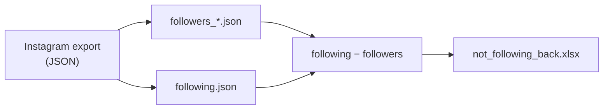

# Instagram Connections Analysis

Find the Instagram accounts you follow that do not follow you back. Runs offline on your own data export.


## Overview

The script reads the follower and following lists from an Instagram data export. It computes the set difference *following − followers* and writes the result to a spreadsheet with clickable profile links. It makes no network requests and uses no Instagram API or third-party service.

## Features

- **Reciprocity analysis.** Lists accounts you follow that do not follow you back.
- **Spreadsheet output.** XLSX with clickable links, column filters and a frozen header.
- **Fully local.** No API keys, no login, no network access.
- **Fast.** Thousands of connections process in seconds.

## How it works



Large accounts get their followers split across several files (`followers_1.json`, `followers_2.json`, …). The script reads all of them.

## Requirements

- Python 3.9+
- An Instagram account to export data from

## Getting started

### 1. Request your data from Instagram

Instagram's menu labels change over time. The path below was current at the time of writing.

1. In the app, open your profile, then the menu (top right).
2. Go to **Accounts Center → Your information and permissions → Export your information**.
3. Tap **Create export**, select the account, then **Export to device**.
4. Tap **Customize information**. Uncheck everything except **Followers and following**, under **Connections**.
5. Set **Format** to **JSON** and **Date range** to **All time**.
6. Tap **Start export** and confirm with your password.

Instagram emails you when the export is ready. This takes from a few minutes to a few hours.

### 2. Add the export to the project

Download and extract the `.zip`. Move its `connections/` folder into the project root:

```
ig-connections-analysis/
├── ig_connections_analysis.py
├── requirements.txt
└── connections/
    └── followers_and_following/
        ├── followers_1.json
        └── following.json
```

### 3. Install dependencies

```bash
python -m venv .venv
source .venv/bin/activate        # Windows: .venv\Scripts\activate
pip install -r requirements.txt
```

### 4. Run

```bash
python ig_connections_analysis.py
```

Paths are resolved relative to the script, so it can run from any working directory.

## Output

`not_following_back.xlsx` has one row per non-reciprocal follow:

| Column | Description |
|---|---|
| `username` | Account username |
| `profile_url` | Clickable link to the profile |
| `followed_since` | When you started following the account (UTC) |

## Privacy

- Your data stays on your machine. The script makes no network requests.
- `connections/` and the output file are git-ignored.
- The output lists other people's usernames. Share it only if you choose to.

## Limitations

- **The export is a snapshot.** Accounts that followed you after the export date still appear. Request a fresh export before a cleanup session.
- **Stale links.** Deleted, deactivated or renamed accounts open Instagram's "page not available" screen. Instagram removes deleted accounts from your following list on its own.

## Project structure

```
ig-connections-analysis/
├── ig_connections_analysis.py   # Main script
├── requirements.txt
├── connections/                 # Your Instagram export (git-ignored)
├── not_following_back.xlsx      # Output (git-ignored)
├── LICENSE
└── README.md
```

## Roadmap

- [ ] CLI flags for input and output paths
- [ ] Optional CSV output
- [ ] Mutual-follow detection with a Venn diagram
- [ ] Support for the "close friends", "blocked" and "muted" lists in the same export
- [ ] Installable package on PyPI

## License

Released under the [MIT License](LICENSE).

## Author

**Cassiano Ribeiro Carneiro** · [@cassianorcarneiro](https://github.com/cassianorcarneiro)

## AI assistance

Claude (Anthropic) was used to refactor the structure and formatting of this repository. The core logic is the author's own work.
